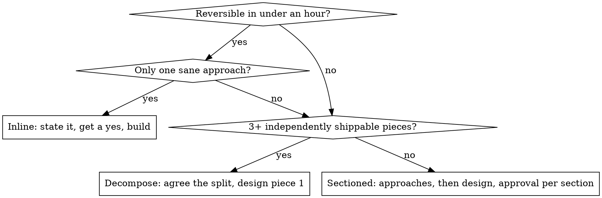

# Brainstorming

Turn an idea into a design the user has actually agreed to, before it becomes code.

**Core principle: the user approves a design, not a diff.** A diff is agreement extracted after
the work became expensive to change.

**This skill assumes the problem is known.** When you cannot state in one sentence what goes
wrong today, or what success would look like, there is nothing to design against yet — that is
`eliciting-requirements`, and it comes first. Most requests do not need it.

## The gate

<HARD-GATE>
No code, no scaffolding, no file creation, no implementation skill until you have stated a
design and the user has approved it. Every time. Including the simple ones.
</HARD-GATE>

**The gate is on approval, not on ceremony.** The design scales all the way down to two
sentences in chat with no file written. Skipping the gate is never right; making it heavy
usually isn't either. A skill that demands a spec document for a typo fix gets turned off, and
then it protects nothing.

## How much design

| Tier | Output |
|---|---|
| **Inline** | 2–4 sentences, one yes, build. No file, no sections, no alternatives. |
| **Sectioned** | 2–3 approaches with a recommendation → design in sections → a yes per section. |
| **Decompose** | Name the pieces, their order, and what depends on what. Agree the split. Then design piece one **only** — each piece gets its own cycle. |

The trigger for **Decompose** is concrete: you would name three or more components that could
ship on separate days, or you cannot state the success criterion in one sentence. Don't spend
questions refining a project that needs splitting first.

## Asking

- Explore the repo before asking. A question the codebase already answers costs you credibility
  and a round trip.
- Use **AskUserQuestion** for anything with discrete options — it is a better instrument than
  prose, and the user can answer three things in one pass.
- **Batch only genuinely independent questions**, four maximum. If the answer to one changes
  what you would ask next, ask it alone and wait.
- Ask about the problem and its constraints. Don't ask the user to make decisions you are
  supposed to be making — "which HTTP library" is your job unless they have a stake in it.
- **Stopping rule: stop when you can state the design and its biggest risk without hedging.**
  If you cannot say what a new answer would change, you are interrogating, not designing.

## Proposing

- Recommendation first, with the reason. A neutral menu pushes your job onto the user.
- **YAGNI each approach before presenting it**, not after. Cut the speculative feature, then
  show what's left.
- Name the tradeoff that actually decides it: what each approach costs *when it turns out to be
  wrong*. "Simpler" and "more flexible" decide nothing.
- If one approach is plainly correct, say so. Don't manufacture two alternatives to look
  thorough — that wastes the user's attention on options you already rejected.

## Presenting

Cover only what applies: what it does, how it splits, data flow, failure modes, how it gets
verified. Scale each to its own complexity — a sentence when it's obvious, a paragraph when it
isn't. For sectioned designs, take a yes per section; a late "actually, no" is cheaper at a
section boundary than at the end.

**Boundaries:** every unit should have one purpose, a stated interface, and be understandable
without reading its internals. If you cannot say what a unit does, how it is used, and what it
depends on, the split is wrong. Large files are usually a symptom of that.

**Existing codebases:** follow the patterns already there. Include targeted fixes to code that
is genuinely in the way of this change — the way a good developer improves what they touch.
Don't propose unrelated refactoring.

## Showing instead of telling

When the question *is* visual — layout, hierarchy, a diagram, two designs side by side — build
it and give the user a link rather than describing it. See
[`references/visual-brainstorming.md`](references/visual-brainstorming.md).

A question about a UI topic is not automatically a visual question. "What should personality
mean here?" is conceptual — ask it in chat. "Which of these two layouts?" is visual — show it.

## After approval

**Write a spec only when it earns its keep:** the work spans sessions, someone else reviews it,
or the decisions will otherwise be re-litigated. Then `docs/design/YYYY-MM-DD-<topic>.md`
(user's preference wins if they have one). Inline-tier designs get no file.

Before showing the spec, re-read it for placeholders and TBDs, sections that contradict each
other, requirements that could be read two ways, and scope that has crept past one plan's
worth. Fix inline and move on — no second review pass.

Committing it is `git-workflow`'s job, not this skill's.

Then hand off: **writing-plans** for multi-step work, straight to implementation for
inline-tier designs. Do not invoke any other implementation skill from here.

## Rationalizations

| Excuse | Reality |
|---|---|
| "They described exactly what they want" | They described a solution. You still don't know the constraint that rules it out. |
| "It's one line" | Then the design is one line. Say it, get the yes — ten seconds. |
| "They said just do it" | They are declining ceremony, not thinking. Give the two-sentence version and proceed. |
| "I'll show them the result instead" | The result *is* the design, presented at the point where changing it is expensive. |
| "It's a bugfix, not creative work" | A fix that changes behaviour is a design decision with a bug for an excuse. |
| "I read the codebase, so I know the design" | Exploration is input. Agreement is the gate. |
| "The design is obvious" | Then it costs one sentence. Obviousness argues for a *short* design, never for none. |
| "They're in a hurry" | The rework is slower than the sentence. |
| "I'll design it and ask forgiveness" | You will have anchored them to your first idea and called it approval. |

## Red flags — stop

- Editing a file when no approval exists yet
- "I'll clarify as I go"
- A sixth question with no decision hanging on it
- Three approaches when you already know which one wins
- A spec document for something reversible in ten minutes
- Invoking any implementation skill other than `writing-plans`

## Non-goals

Doesn't write the implementation plan (that's `writing-plans`), the code, or the tests. Doesn't
turn a vague request into a problem statement (`eliciting-requirements`, which runs before this).
Doesn't commit or open PRs (that's `git-workflow`). Doesn't review existing code for correctness.

## Source

Adapted from [obra/superpowers](https://github.com/obra/superpowers).
