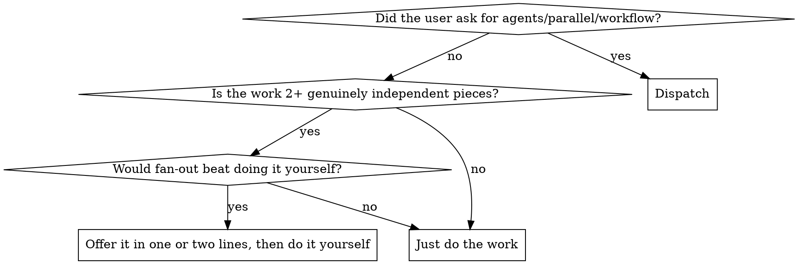

# Dispatching Parallel Agents

Delegating work to agents with isolated context. Each agent gets exactly the context you
construct — never your session history — which keeps them focused and keeps your context free
for coordination.

**Core principle: noticing parallelizable work authorizes you to *offer*, not to dispatch.**

## The gate

Dispatching costs real money and real time on the user's behalf. Spotting an opportunity is not
the same as being asked to take it.



**Counts as asking:** "use subagents", "fan out", "in parallel", "run a workflow", "delegate
this", "ultracode", or invoking a skill or command whose instructions dispatch. A task that
would merely *benefit* from parallelism does not count.

**An offer is two lines, then you keep working.** Name the split, the agent count, the rough
cost, and get on with doing it sequentially — don't stall waiting for an answer:

> Four subsystems fail independently; that's four agents, roughly 4× the tokens of doing it
> myself but done in one pass instead of four. Say "fan out" if you want it — starting on the
> auth one meanwhile.

## What it costs

State this when you offer, because the user is paying it:

- **Tokens scale linearly with agent count.** N agents ≈ N× the cost of doing one yourself, and
  each re-reads context you already have loaded.
- **A bad prompt wastes the entire agent.** There's no mid-course correction on a dispatched
  agent except `SendMessage`.
- **You must verify what comes back.** Agent summaries are claims, not results.

Fan-out buys wall-clock time and context headroom. It does not buy correctness.

## Splitting the work

A split is real when each piece can be understood without the others and no two pieces write the
same file. Group by **problem domain**, not by file count.

| Good split | Why |
|---|---|
| One agent per failing subsystem with a distinct root cause | Fixing one cannot fix or break another |
| One read-only agent per search angle (by directory, by naming convention, by caller) | No writes, no conflicts, and each is blind to what the others find |
| One agent per independent migration site | Mechanical, verifiable, no shared state |

**Not a real split:** related failures where one fix may resolve the others, exploratory work
where you don't yet know what's broken, anything needing full-system context, or two agents that
would edit the same file. For that last case, `isolation: "worktree"` gives each agent its own
checkout — but it costs setup time and disk, so use it only when parallel writes actually
collide.

## The dispatch prompt

A dispatch prompt has exactly these parts, in this order:

1. **The task**, stated as a goal — one problem domain, one sentence.
2. **The evidence** — error text, test names, file paths, verbatim. The agent cannot see your
   session.
3. **The boundary** — which files or directories it may change.
4. **The return contract** — what it must hand back, and in what shape.

```
Fix the 3 failing tests in src/agents/agent-tool-abort.test.ts.

  "should abort tool with partial output capture" — expects 'interrupted at' in message
  "should handle mixed completed and aborted tools" — fast tool aborted instead of completed
  "should properly track pendingToolCount" — expects 3 results, gets 0

These look like race conditions. Find the root cause: a real bug in the abort path, or a test
that races. Replacing a timeout with a longer timeout is not a fix.

Change only src/agents/agent-tool-abort.test.ts and src/agents/abort.ts.

Return: the root cause in one paragraph, the files you changed, and the command that proves it.
```

Everything the agent needs is in the prompt; nothing about how you got there is.

## Picking the agent

| Situation | Choice |
|---|---|
| Read-only sweep — locating code, mapping conventions | `Explore` — returns conclusions, not file dumps |
| Multi-step work, edits, verification | `general-purpose` |
| Parallel writes that would collide | add `isolation: "worktree"` |
| Need the result before you continue | `run_in_background: false` |
| Continuing an agent that already has the context | `SendMessage`, not a fresh `Agent` call |

Deterministic control flow across many agents — pipelines, loops, fan-out over a discovered
work-list — is `Workflow`'s job, not a pile of `Agent` calls. It needs the same explicit opt-in.

**Dispatch every independent agent in one message.** Separate messages run them sequentially and
you paid for parallelism you didn't get.

**Never state or predict a pending agent's results.** Wait for the notification. If asked before
it lands, say it's still running.

## Integrating what comes back

1. **Verify the claim, not the summary.** Run the check yourself. "All tests pass" from an agent
   that never ran them is a common and expensive failure.
2. **Check for collisions** — did two agents touch the same file, and does the combination still
   work? Neither agent saw the other's diff.
3. **Run the full suite once, at the end.** Individually-green pieces can be jointly red.
4. **Relay conclusions, not transcripts.** The user never sees the agent's report; that's the
   whole point of delegating.

A returned `null` means the agent died or was skipped — filter those before using results, and
say that it happened rather than quietly continuing with fewer results than you promised.

## Red flags — stop

- Dispatching because the work looks parallel, without having been asked
- An offer longer than the work it would save
- "Fix all the tests" as a dispatch prompt
- Reporting an agent's summary as verified fact
- Spawning a second agent for context the first one already has
- Agents dispatched across several messages, then described as parallel

## Non-goals

Doesn't decide *what* to build (that's `brainstorming`), doesn't write plans, doesn't manage git.
Doesn't authorize itself — the gate above is the whole point.

## Source

Adapted from [obra/superpowers](https://github.com/obra/superpowers).
