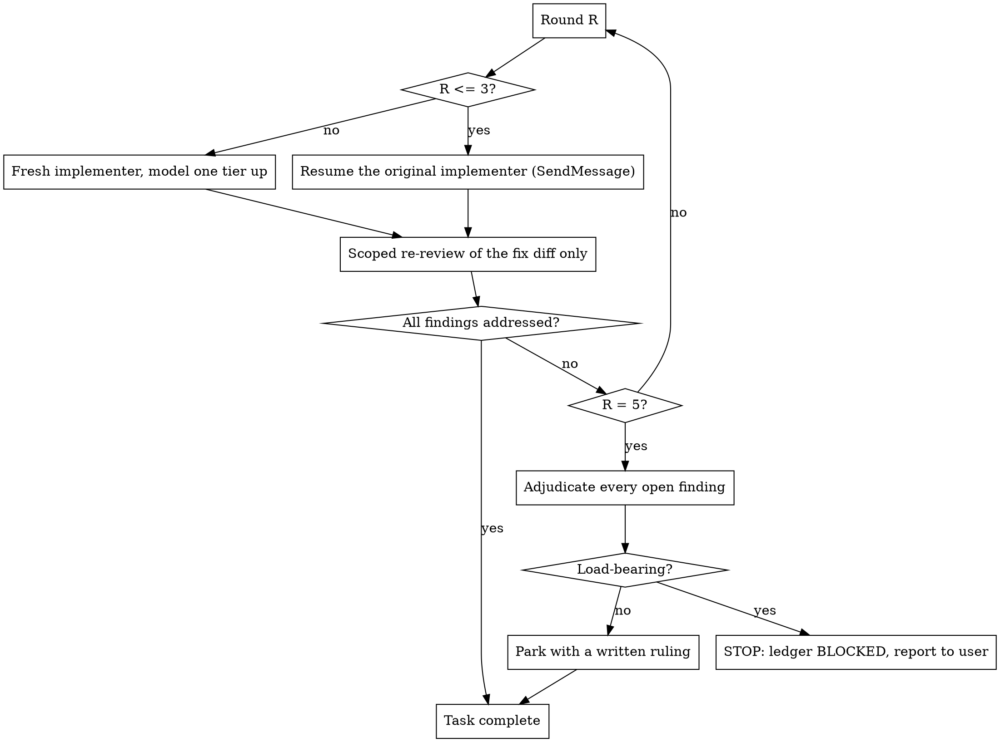

# Subagent-Driven Development

Execute a plan by dispatching a fresh implementer per task, reviewing each task as it lands, and
running one broad review at the end. Each subagent gets exactly the context you construct —
never your session history — which keeps them focused and keeps your context free to coordinate.

**Core principle: you are the controller. You dispatch, review, adjudicate, and record. You do
not implement.**

## The gate

<HARD-GATE>
This skill spends the user's money at scale — one implementer plus at least one reviewer per
task, plus fix rounds. **Do not start it unless the user asked for subagent execution.** A plan
with independent tasks is not an invitation.
</HARD-GATE>

Not asked, but the plan looks like a good fit? Offer it in two lines with the cost, then execute
the plan yourself via `executing-plans` while they decide. See `dispatching-parallel-agents`.

## Setup

**Isolate the workspace.** `using-git-worktrees`. Never start on the default branch —
`git-workflow` owns that rule.

**Create the ledger before dispatching anything.** Conversation memory does not survive
compaction. A controller that loses its place re-dispatches completed tasks; that is the most
expensive failure this skill has, and the ledger is the only thing that prevents it.

```sh
scripts/sdd-workspace.sh PLAN_FILE     # prints <repo>/.sdd/<plan-basename>/, git-ignored
```

One directory per plan, so a later plan can never read or overwrite this one's artifacts. The
ledger lives at `<workspace>/progress.md` and its first line names the plan:

```
# SDD ledger — plan: docs/plans/feature.md
```

**Resuming:** if that file exists and names *your* plan, tasks with a `Task <N>: complete` line
are done — do not re-dispatch them. Resume at the first task without one; a task whose last line
is a fix round is mid-loop, so resume the loop at the next round. A ledger naming a different
plan belongs to that plan: leave it and start your own. **After a compaction, trust the ledger
and `git log` over your own recollection.**

**Pre-flight the plan once.** Read it, note the global constraints, create a task per plan item,
and scan for tasks that contradict each other or the constraints, and for anything the plan
mandates that a reviewer will call a defect (a test asserting nothing, a duplicated logic
block). Present everything found as **one batched question** — each item beside the plan text
that mandates it, asking which governs — before Task 1, not one interruption per discovery.
Clean scan: proceed without comment.

## Model selection

Use the least capable model that can do the job. **Always specify `model` explicitly** — an
omitted model inherits the session's, usually the most expensive one, which silently defeats
this whole section.

| Work | Model |
|---|---|
| Transcription: the plan contains the code to write | `haiku` |
| Single-file mechanical fixes | `haiku` |
| Implementation from prose, multi-file integration | `sonnet` |
| Reviews, scaled to the diff's risk | `sonnet`; `opus` for subtle concurrency, security, or data-integrity diffs |
| Architecture, judgment, **the final whole-branch review** | `opus` |
| Fix-loop rounds 4–5 | At least one tier above the implementer that got stuck |

**Turn count beats token price.** The cheapest model routinely takes 2–3× the turns on
multi-step work and costs more overall. `sonnet` is the floor for reviewers and for implementers
working from prose.

## The task loop

Everything you paste into a dispatch, and everything a subagent prints back, stays in your
context for the rest of the session and is re-read every turn. **Hand artifacts over as file
paths.**

### 1. Dispatch the implementer

Record `BASE=$(git rev-parse HEAD)` first — the review package needs it, and `HEAD~1` silently
drops all but the last commit of a multi-commit task.

```sh
scripts/task-brief.sh PLAN_FILE N      # extracts task N's text to a file, prints the path
```

The dispatch contains: one line on where this task fits; the brief path, introduced as "read
this first — your requirements, use its exact values verbatim"; interfaces and decisions from
earlier tasks the brief cannot know; your resolution of any ambiguity you spotted; and the
report-file path. **Exact values live only in the brief.** Never make a subagent read the whole
plan.

Name the report file after the brief (`task-N-brief.md` → `task-N-report.md`).

A dispatch describes one task, not the session's history — do not paste "state after tasks 1–3"
into later dispatches. **Never dispatch two implementers in parallel**; they conflict. Record the
agent's identity from the result so fix rounds can resume it.

Template: [`references/implementer-prompt.md`](references/implementer-prompt.md)

### 2. Handle the report

| Status | Do |
|---|---|
| `DONE` | Build the review package, dispatch the task reviewer |
| `DONE_WITH_CONCERNS` | Read the concerns. Correctness or scope → address before review. Observations → note and proceed |
| `NEEDS_CONTEXT` | Supply what was missing, re-dispatch |
| `BLOCKED` | Diagnose: missing context → re-dispatch with it; needs more reasoning → better model; too large → split it; plan is wrong → ask the user |

**Never re-dispatch the same model on the same input after a BLOCKED.** If it said it was stuck,
something has to change.

### 3. Review the task

```sh
scripts/review-package.sh PLAN_FILE BASE HEAD   # commits + stat + diff to one file, prints path
```

The package never enters your context; the reviewer reads it in one call. **Never dispatch a
task reviewer without a diff file.**

The reviewer gets three paths — brief, report, review package — plus the global constraints that
bind this task, copied verbatim from the plan: exact values, formats, and stated relationships.
The template already carries the process rules.

**Do not pre-judge findings.** If your prompt contains "don't flag", "at most Minor", or "the
plan chose this" — stop. You are sparing yourself a review loop. Let the reviewer raise it and
adjudicate properly.

Reviewers may return **⚠️ cannot verify from diff** items — requirements living in unchanged code
or spanning tasks. Those don't block the review, but you must resolve each yourself before
marking the task complete; you hold the cross-task context. A confirmed gap enters the fix loop.

Template: [`references/task-reviewer-prompt.md`](references/task-reviewer-prompt.md)

### 4. The fix loop

Triggered by spec ❌, any Critical or Important finding, or a ⚠️ you confirmed.

Two things leave immediately: **Minor findings** go straight to the ledger
(`Task N: minor (deferred): …`) and never enter the loop — point the final review at that list.
**Plan-mandated findings** are the user's call: present the finding and the plan text, ask which
governs. Don't dismiss it because the plan mandated it, and don't fix against the plan without
asking.



**Rounds 1–3 resume the original implementer** via `SendMessage` — its context is intact; it
knows the task, the code, and its own choices. Send the open findings verbatim.

**Rounds 4–5 dispatch a fresh implementer one tier up**, with the brief path, the report path,
the open findings, and: "A prior implementer attempted this N times; you own it now. Read the
report file for what was tried." Three failed resumes usually means it can't see its own
problem.

**Every round:** the implementer fixes, re-runs the tests covering the amended code, and appends
a fix report to the same report file. Confirm that report names the covering tests, the command,
and the output *before* dispatching the re-review.

**The re-review is scoped** — `review-package.sh PLAN_FILE FIX_BASE HEAD` where FIX_BASE is the
head the previous review saw. It verdicts each finding ADDRESSED or NOT ADDRESSED and flags new
breakage in the fix diff only. Out-of-scope observations go to the ledger; they never extend the
loop.

Ledger every round: `Task N: fix round R/5 (X addressed, Y open — <one-liners>; commits a7..b7)`

**Never fix findings yourself.** Controller fixes pollute your context and skip review entirely.

**The breaker.** Round 5 still open → stop dispatching and adjudicate each finding yourself:

- **Reviewer wrong or contestable** → park: `Task N: parked — <finding> — ruling: <why it stands>`
- **Real but nothing builds on it** → park the same way, ruling says real-and-deferred
- **Real and load-bearing** (a later task depends on it, or it exposes a plan defect) → **STOP.**
  Ledger `Task N: BLOCKED — <reason>` and report to the user with the finding, the plan text it
  collides with, and the fix history. Parking a structural failure lets every later task build
  on it.

Adjudicate **only at the cap**. Adjudicating early to end a loop is pre-judging with a nicer
name. Every adjudication is a ledger line — silent discards are forbidden.

### 5. Complete

`Task N: complete (commits base7..head7, review clean)` — or `(…, K parked)` after a tripped
breaker. Mark the todo, move on. Never advance with open Critical/Important findings that are
neither fixed nor parked-with-ruling at the cap.

## Running the loop

**Do not check in between tasks.** No "should I continue?", no progress summaries. They asked
for the plan to be executed; execute it. Stop only for: an unresolvable BLOCKED, ambiguity that
genuinely prevents progress, or completion.

Between tool calls, narrate at most one short line — the ledger and the tool results are the
record.

## Final review

`review-package.sh PLAN_FILE $(git merge-base main HEAD) HEAD`, dispatched on `opus` using
[`requesting-code-review`'s reviewer prompt](../requesting-code-review/references/reviewer-prompt.md).
Point it at the ledger's deferred-minor and parked lines so it can triage what must be fixed
before merge.

Findings → **one** fix dispatch with the complete list, not one fixer per finding; per-finding
fixers each rebuild context and re-run suites. Then exactly one scoped re-review. Adjudicate
residuals as at the breaker. **There is no second fix wave** — residual load-bearing findings go
to the user.

Clean → delete this plan's workspace (`rm -rf <workspace>`); git history is the record now.
Leave sibling directories alone. Then hand off to `git-workflow` to land the branch.

## Rationalizations

| Excuse | Reality |
|---|---|
| "The plan has independent tasks, so this applies" | Only if the user asked. Fit is not permission |
| "Close enough on spec compliance" | Spec gaps mean not done. Fix, or hit the cap and adjudicate |
| "I'll just fix it myself, dispatching is overhead" | Controller fixes pollute your context and skip review entirely |
| "One more round will converge" | Past the cap, rounds don't converge — the failure is structural |
| "This finding is obviously wrong, I'll drop it" | You adjudicate at the cap, in writing, in the ledger |
| "The fix was small, skip the re-review" | Unreviewed fixes are how regressions land |
| "Ledger bookkeeping is overhead" | It is what survives compaction. Without it, controllers re-run finished work |
| "I'll paste the plan into the dispatch, it's simpler" | Then every later turn re-reads it. Hand over paths |

## Red flags — stop

- Starting without having been asked
- Dispatching without a ledger
- Two implementers in flight at once
- A dispatch prompt carrying prior-task history
- Writing "don't flag X" into a reviewer prompt
- Fixing a finding yourself
- A sixth fix round
- Marking complete with open findings and no rulings

## Non-goals

Doesn't write the plan (`writing-plans`) or the design (`brainstorming`). Doesn't land the branch
(`git-workflow`). Doesn't execute plans single-handed (`executing-plans`).

## Source

Adapted from [obra/superpowers](https://github.com/obra/superpowers).
