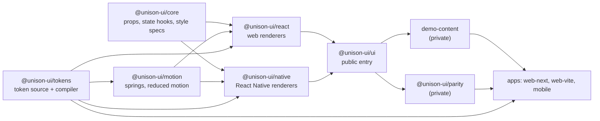
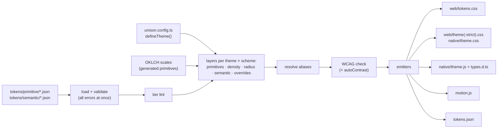

# Architecture

How the Unison monorepo is put together at the end of phase 0. The decisions behind it are in
[docs/adr](adr/).

## Package graph



- `tokens` holds the token source (DTCG JSON, primitive and semantic tiers) and the compiler that
  turns it, plus each app's `unison.config.ts`, into CSS variables, Tailwind v4 themes, a native
  Tailwind (Uniwind) theme, a typed native theme object, motion presets and `tokens.json`.
- `core` and `motion/src/shared` hold platform-free code. `react` and `native` hold only
  renderers. `ui` picks one of them per platform.
- Every library builds to `dist/` with tsdown (ESM only). Apps consume `dist/`, never `src/`.

## What may import what

Enforced by `tooling/scripts/check-boundaries.ts` (part of `pnpm lint`):

| Files | Must not import |
| --- | --- |
| `packages/tokens`, `packages/core`, `packages/motion/src/shared/**` | `react-dom`, `react-native`, `react-native-*`, `@unison-ui/react`, `@unison-ui/native`, `@unison-ui/ui` |
| `packages/motion/src/web/**`, `packages/react/**` | `react-native`, `react-native-*`, `@unison-ui/native`, `@unison-ui/ui` |
| `packages/motion/src/native/**`, `packages/native/**` | `react-dom`, `@unison-ui/react`, `@unison-ui/ui` |
| any package | a relative import that leaves its own package |

The renderers count as platform imports because they pull in `react-dom` or `react-native`
transitively. The check reads static and side-effect imports, re-exports, `import()` and
`require()` (string or plain template literal), and ignores comments.

TypeScript backs this up: `tokens`, `core` and `motion/src/shared` are typechecked without the DOM
lib, so a stray `window` or `document` fails.

## How `ui` picks a platform

The split happens at package level ([ADR 0008](adr/0008-package-level-platform-split.md)).
`@unison-ui/ui`'s `package.json`:

```json
"exports": {
  ".": {
    "types": "./dist/web.d.ts",
    "react-native": "./dist/native.js",
    "browser": "./dist/web.js",
    "default": "./dist/web.js"
  }
},
"react-native": "./dist/native.js"
```

| Bundler | Condition it matches | Result |
| --- | --- | --- |
| Metro (Expo) | `react-native` | `dist/native.js` → `@unison-ui/native` |
| Vite, Next.js client | `browser` | `dist/web.js` → `@unison-ui/react` |
| Next.js server (React Server Components) | `default` | `dist/web.js` → `@unison-ui/react` |

`@unison-ui/motion` uses the same pattern (`react-native` → `dist/native`, `default` →
`dist/web`). Both builds expose identical signatures, which a type test checks.

**Server Components.** `Box` has no hooks and no directive, so it renders on the server.
`MotionBadge` and `useControllableState` each start with `"use client"`. Packages are built
unbundled so the directive stays on that one module, not the package root.

## From a token to a pixel

### The pipeline



1. `load.ts` reads `tokens/primitive/*.json` and `tokens/semantic/*.json` (`color.light.json` /
   `color.dark.json` hold the scheme-specific colours). `validate.ts` normalises every value
   (`"8px"` → `{ value: 8, unit: "px" }`) and collects every error.
2. `lint-tiers.ts` enforces the tiers: semantic tokens alias primitives (or are marked raw), and
   every semantic colour exists in both schemes.
3. For each theme in the app's `unison.config.ts` (default: the package's own default theme),
   `buildTheme()` stacks layers per scheme. The layers are the OKLCH colour scales generated from
   the accent and neutral ([ADR 0012](adr/0012-oklch-generation-and-gamut-mapping.md)), the hand-
   written primitives, the density and radius options, the semantic tokens, and the config's
   `overrides`. `resolve.ts` resolves the aliases (cycles and type mismatches are errors) into one
   flat map per theme × scheme.
4. `color/auto-contrast.ts` checks every WCAG pair and fails the build, or nudges a text colour,
   when `autoContrast` is on ([ADR 0014](adr/0014-wcag-enforced-apca-informational.md)).
5. The emitters write the outputs. `unison-tokens build --config unison.config.ts --out unison`
   writes them into the app's `unison/` folder, and the package's own build writes the default
   theme into `dist/` ([ADR 0019](adr/0019-app-config-and-unison-folder.md)).

### Web

1. `unison/web/tokens.css` declares every token as a `--unison-*` variable. Semantic tokens are
   references (`--unison-color-accent: var(--unison-color-accent-600)`), and colour primitives come
   as hex with an `oklch()` re-declaration under `@supports`. Dark mode and every named theme are
   blocks that re-declare only what resolves differently, selected by `data-theme` and
   `data-unison-theme` ([ADR 0018](adr/0018-theme-attributes-and-scoping.md)).
2. `unison/web/theme.css` (or `theme-strict.css`) maps Tailwind's namespaces onto them:
   `--color-accent: var(--unison-color-accent)` inside `@theme inline`, so classes follow a runtime
   switch.
3. `Box` builds its inline style with `cssVar("color.accent")` → `var(--unison-color-accent)`, and
   app code writes `bg-accent`. Both resolve through the same variable.
4. `ThemeScript` sets the two attributes on `<html>` before paint, and `ThemeProvider` / `useTheme`
   change them.

### Native

1. `unison/native/theme.js` exports `themes = { [theme]: { light, dark } }` with flat groups
   (`color["accent-600"]`, `motion.duration["fast-enter"]`; see `nativeKey`), dimensions as numbers,
   text styles as `{ fontFamily, fontSize, lineHeight, letterSpacing }` (the face per weight, no
   `fontWeight`) and shadows as `boxShadow` strings. `types.d.ts` holds `UnisonTheme` and
   `SemanticTokenValues`.
2. `UnisonProvider` picks `themes[theme][scheme]`, and `Box` reads it with `useUnisonTheme()` and
   `token(theme, "color.accent")`. `token()` only accepts semantic paths
   ([ADR 0017](adr/0017-semantic-only-token-access.md)).
3. Tailwind classes go through Uniwind ([ADR 0005](adr/0005-native-tailwind-engine.md)) with
   `unison/native/theme.css`: literal values per `@variant light` / `dark` /
   `<theme>-<scheme>`, because Uniwind can't resolve the web `var()` chain. `UnisonProvider`'s
   `onThemeChange` tells Uniwind which variant is active.

While `pnpm dev` runs, editing `unison.config.ts` (or the token source) rebuilds `unison/` (or
`dist/`), and the apps update without a restart.

## Parity harness

`packages/parity` renders each fixture (component × case × light/dark) on four platforms through
the same `@unison-ui/ui` import:

- web: the Vite app's `/parity/...` routes, in Chromium and WebKit
- iOS and Android: the Expo app's `unison-demo://parity/...` routes, on release builds

It compares the subject's position and size across `web-chromium`, iOS and Android (±1 px), and
compares screenshots only against each platform's own baselines. See CONTRIBUTING.md, section 4.
