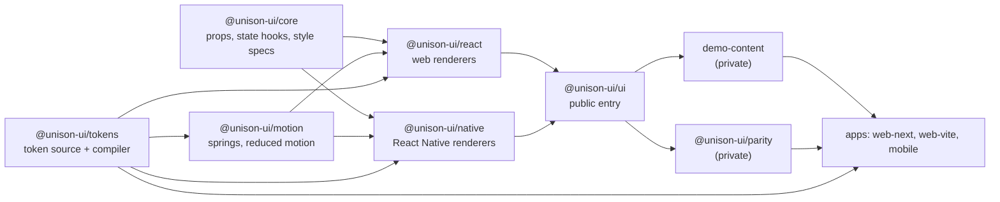

# Architecture

How the Unison monorepo is put together at the end of phase 0. The decisions behind it are in
[docs/adr](adr/).

## Package graph



- `tokens` turns `tokens/base.json` and `tokens/dark.json` (DTCG) into CSS variables, a Tailwind v4
  theme, a native Tailwind (Uniwind) theme and a typed native theme object.
- `core` and `motion/src/shared` hold platform-free code. `react` and `native` hold only
  renderers. `ui` picks one of them per platform.
- Every library builds to `dist/` with tsdown (ESM only). Apps consume `dist/`, never `src/`.

## What may import what

Enforced by `tooling/scripts/check-boundaries.ts` (part of `pnpm lint`):

| Files | Must not import |
| --- | --- |
| `packages/tokens`, `packages/core`, `packages/motion/src/shared/**` | `react-dom`, `react-native`, `react-native-*` |
| `packages/motion/src/web/**`, `packages/react/**` | `react-native`, `react-native-*` |
| `packages/motion/src/native/**`, `packages/native/**` | `react-dom` |
| any package | a relative import that leaves its own package |

TypeScript backs this up: `tokens`, `core` and `motion/src/shared` are typechecked without the DOM
lib, so a stray `window` or `document` fails.

## How `ui` picks a platform

The split happens at package level ([ADR 0008](adr/0008-package-level-platform-split.md)).
`@unison-ui/ui`'s `package.json`:

```json
"exports": {
  ".": {
    "types": "./dist/web.d.ts",
    "react-native": "./dist/native.js",
    "browser": "./dist/web.js",
    "default": "./dist/web.js"
  }
},
"react-native": "./dist/native.js"
```

| Bundler | Condition it matches | Result |
| --- | --- | --- |
| Metro (Expo) | `react-native` | `dist/native.js` → `@unison-ui/native` |
| Vite, Next.js client | `browser` | `dist/web.js` → `@unison-ui/react` |
| Next.js server (React Server Components) | `default` | `dist/web.js` → `@unison-ui/react` |

`@unison-ui/motion` uses the same pattern (`react-native` → `dist/native`, `default` →
`dist/web`). Both builds expose identical signatures, which a type test checks.

**Server Components.** `Box` has no hooks and no directive, so it renders on the server.
`MotionBadge` and `useControllableState` each start with `"use client"`. Packages are built
unbundled so the directive stays on that one module, not the package root.

## From a token to a pixel

### Web

1. `packages/tokens/tokens/base.json`: `color.accent = #5b5bd6`.
2. `unison-tokens build` writes `dist/web/tokens.css`: `:root { --unison-color-accent: #5b5bd6 }`,
   with dark overrides under `[data-theme="dark"]` and `prefers-color-scheme: dark`.
3. `dist/web/theme.css` maps Tailwind's theme onto it: `--color-accent: var(--unison-color-accent)`.
4. An app imports `tailwindcss`, `@unison-ui/tokens/tokens.css` and `@unison-ui/tokens/theme.css`.
   From there:
   - `Box` uses an inline style built by `cssVar("color.accent")` → `var(--unison-color-accent)`.
   - App code can write the Tailwind utility `bg-accent`.

   Both resolve to the same variable, so a token change updates both with no rebuild of the
   components.

### Native

1. The same `base.json` and `dark.json`.
2. `dist/native/theme.js` exports `themes = { light, dark }`, with dimensions as numbers, durations
   in ms and springs as `{ stiffness, damping, mass }`. `dist/native/theme.d.ts` holds the
   generated `UnisonTheme` type.
3. `Box` calls `useUnisonTheme()` (picks `themes[light|dark]` from `useColorScheme()`) and
   `token(theme, "color.accent")`, a typed dot-path lookup, to build its `style`.
4. App code using Tailwind classes goes through Uniwind
   ([ADR 0005](adr/0005-native-tailwind-engine.md)):
   - The app imports `@unison-ui/tokens/native-theme.css`, which holds literal colours per
     `@variant light` / `@variant dark`, plus `--spacing` and `--radius-md`.
   - Uniwind can't resolve the web `var(--unison-…)` chain on native, which is why this file
     exists.

In both cases, saving `base.json` while `pnpm dev` runs rebuilds `dist/` and the apps update
without a restart.

## Parity harness

`packages/parity` renders each fixture (component × case × light/dark) on four platforms through
the same `@unison-ui/ui` import:

- web: the Vite app's `/parity/...` routes, in Chromium and WebKit
- iOS and Android: the Expo app's `unison-demo://parity/...` routes, on release builds

It compares the subject's position and size across `web-chromium`, iOS and Android (±1 px), and
compares screenshots only against each platform's own baselines. See CONTRIBUTING.md, section 4.
